# Database design (Phase 2)

PostgreSQL schema managed with Prisma (multi-file schema in `prisma/schema/`, one file per domain).
66 models. Migrations: `prisma/migrations/`. This document is the reference for the
relationships, the integrity rules the database enforces on its own, deletion behaviour and the data lifecycle.

Contents: [Tenancy model](#tenancy-model) · [Design decisions](#design-decisions) · [Diagrams](#diagrams) ·
[Key relationships](#key-relationships) · [Integrity beyond foreign keys](#integrity-beyond-foreign-keys) ·
[Duplicate prevention](#duplicate-prevention) · [Deletion behaviour](#deletion-behaviour) ·
[History and append-only data](#history-and-append-only-data) · [Secrets](#secrets) · [Data lifecycle](#data-lifecycle) ·
[Conventions and operations](#conventions-and-operations)

## Tenancy model

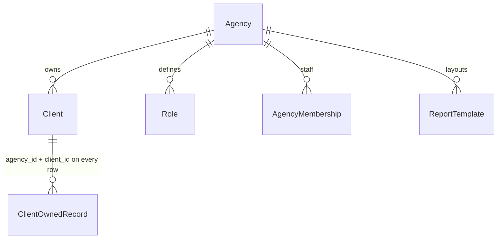

* **Agency** is the top tenant. **Client** (a business the agency manages, e.g. SARJ Worldwide) belongs to exactly one agency.
* Every client-owned table (48 of them) carries `agency_id` **and** `client_id`. `client_id` is nullable only on rows that can also exist at agency or
  system level (`notifications`, `idempotency_keys`, `webhook_events`, `job_runs`, `audit_log`). All of them except `audit_log` have a composite foreign key
  `(client_id, agency_id) -> clients(id, agency_id)`; `audit_log` is checked by a trigger instead (see below). Because `clients` is unique on `(id, agency_id)`, a row can never
  name a client from another agency, and the pair can never drift apart.
* Client-owned tables reference **each other** through keys that include `client_id`, e.g.
  `tasks(project_id, client_id) -> projects(id, client_id)`. Linking a task to another client's project, a report to another
  client's template, or a sync run to another client's integration account fails inside PostgreSQL (foreign key violation),
  whatever the application does.
* Agency-level tables (`roles`, `agency_memberships`, `report_templates`, ...) are keyed by `agency_id`. A role or template
  can only be used by that agency's memberships/reports (composite FKs again).
* Global tables hold no tenant data: `permissions`, `integrations` (provider catalogue), `metric_definitions`, and Better Auth's
  `users`, `sessions`, `accounts`, `verifications`.

Authorization is enforced server-side in `@automation/db`, in three independent layers:

| Layer | Where | What it stops |
| --- | --- | --- |
| Database constraints | composite FKs, CHECKs, triggers (this document) | cross-client/cross-agency links, plaintext secrets, publishing without approval, edits to history |
| Scoped Prisma client | `forClient/forClients/getActorDb` in `src/scope.ts` | queries that forget the tenant filter; every client-owned model is auto-filtered, agency-level models are filtered through the agencies of the scoped clients, and a test fails if a model is not classified |
| Permissions | `requirePermission` / `requireAgencyPermission` in `src/access.ts`, role -> permission rows | actions the user's role does not allow (platform admin > agency role > client role) |

## Design decisions

The request listed ~75 models. These were merged or adjusted to avoid duplicates:

| Requested | Decision | Why |
| --- | --- | --- |
| Customer (existing) | Renamed to **Client** (migration `rename_customer_to_client`) | Client is the same concept; keeping both would duplicate it |
| IntegrationConnection (existing) | Replaced by **Integration** (provider catalogue) + **IntegrationAccount** (a client's connection) | One provider row per provider, many client accounts; the old table was empty and the migration refuses to drop it if it is not |
| Membership (existing, enum role) | Replaced by **ClientMembership** + **Role** rows | Roles/permissions are data (agency-defined), not a hard-coded enum |
| One role per membership (Phase 2) | **Phase 3:** `agency_membership_roles` / `client_membership_roles` link tables | A user can hold several roles; effective permissions are the union (see [auth.md](auth.md)) |
| Invitation (Phase 3) | **Invitation** + **InvitationRole** | Emailed, single-use, hash-only token; can target the agency or one client |
| TaskAssignmentHistory | Folded into **TaskEvent** (`assigned`/`unassigned` events with `from_value`/`to_value`) | Same append-only shape as every other task event |
| MetricSyncHistory | Folded into **SyncRun** (`analytics_source_id`, `covered_from/to`, `rows_*`) | A metric sync is a sync run; one history table |
| SEOProject | Kept as a **1:1 extension of Project** (`seo_projects.project_id` unique) | Project stays generic; SEO-only settings (website, country, language) live here |
| ReportTemplate | **Agency-level** (no `client_id`) | Layouts are reused across an agency's clients; per-client tweaks go in `reports.config` |
| NotificationPreference | Per **(agency, user, event type, channel)** | Avoids nullable-scope uniqueness holes; the user must be an agency member (FK) |
| WebsitePage / Website | **Website** (existing) kept and extended; **WebsitePage** added under it | Website is the domain registry, pages are crawl data |
| JobRun (existing) | Kept | Worker heartbeat bookkeeping, distinct from AutomationRun and SyncRun |

Naming: `Seo*` (not `SEO*`) to keep Prisma accessors readable (`db.seoIssue`). Tables are snake_case plural via `@@map`.

## Diagrams

Column lists show keys and the most important fields only; the Prisma schema is authoritative. `FK` columns that are part of a
composite key always travel with `client_id` (see above). The `Client` link that every client-owned table has is described
in [Tenancy model](#tenancy-model) rather than drawn 48 times.

### Identity, agencies and access control

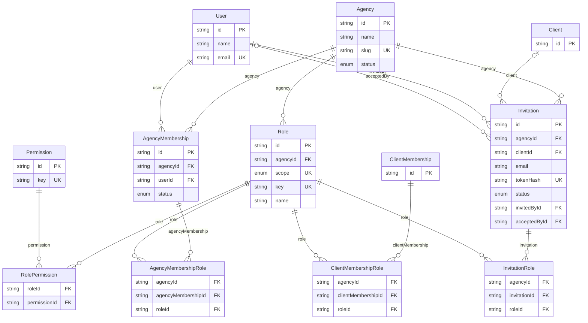

### Clients, projects and websites

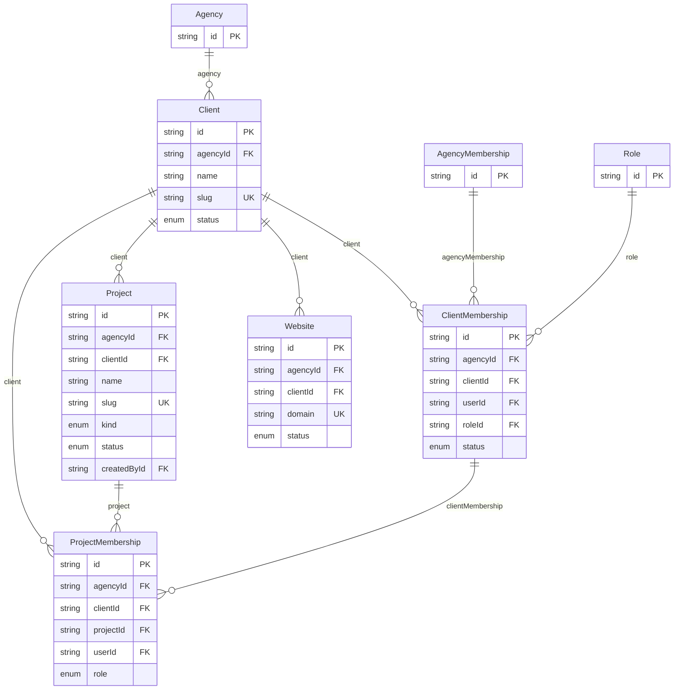

### Integrations and syncing

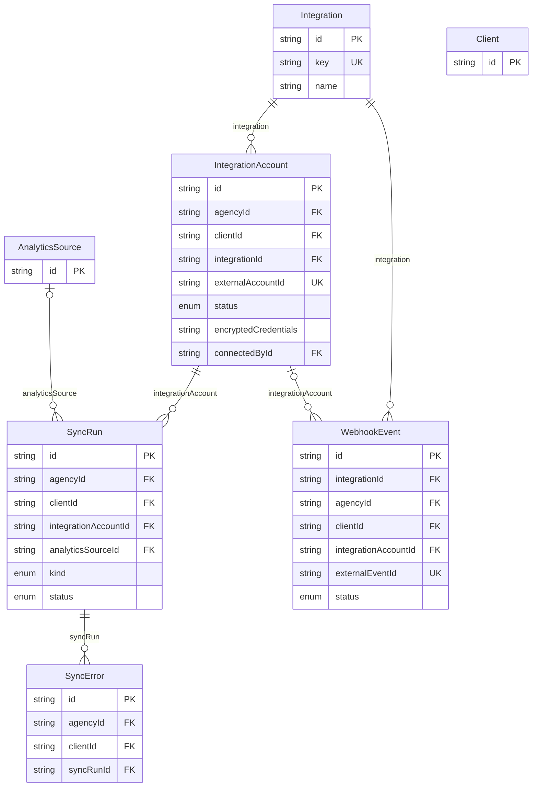

### SEO

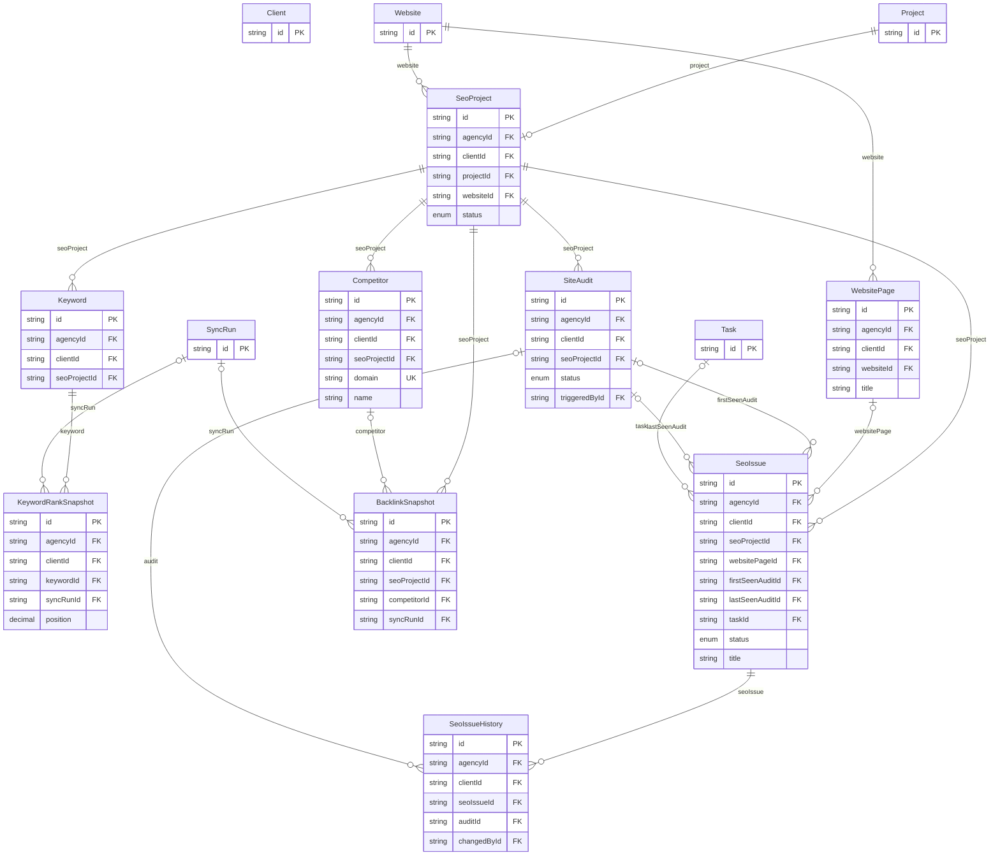

### Tasks and time

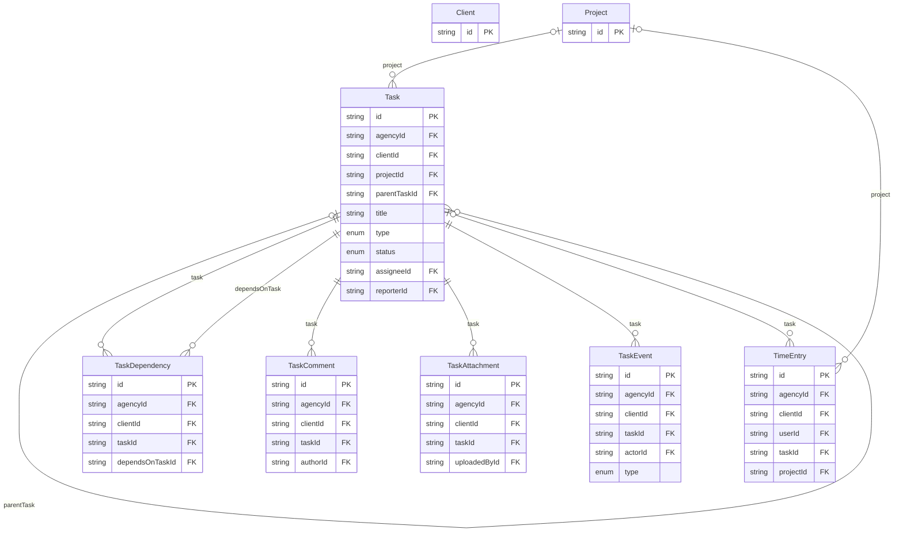

### Automation

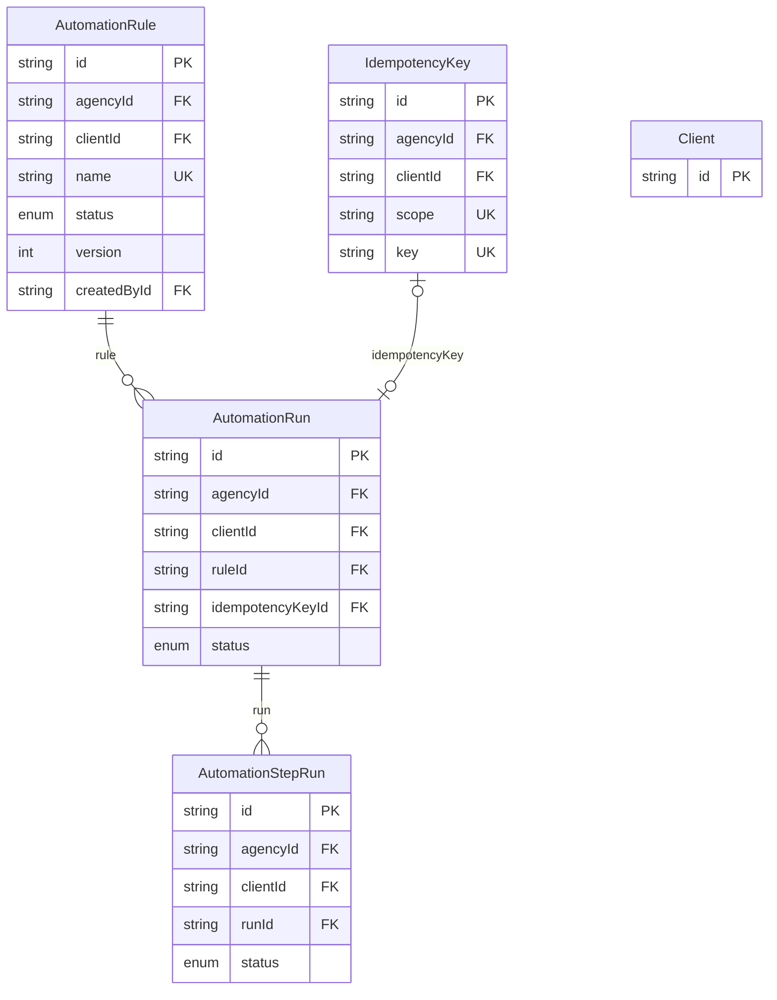

### Content and AI

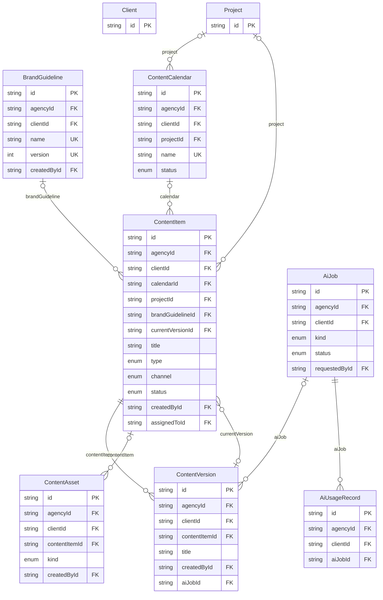

### Approval and publishing

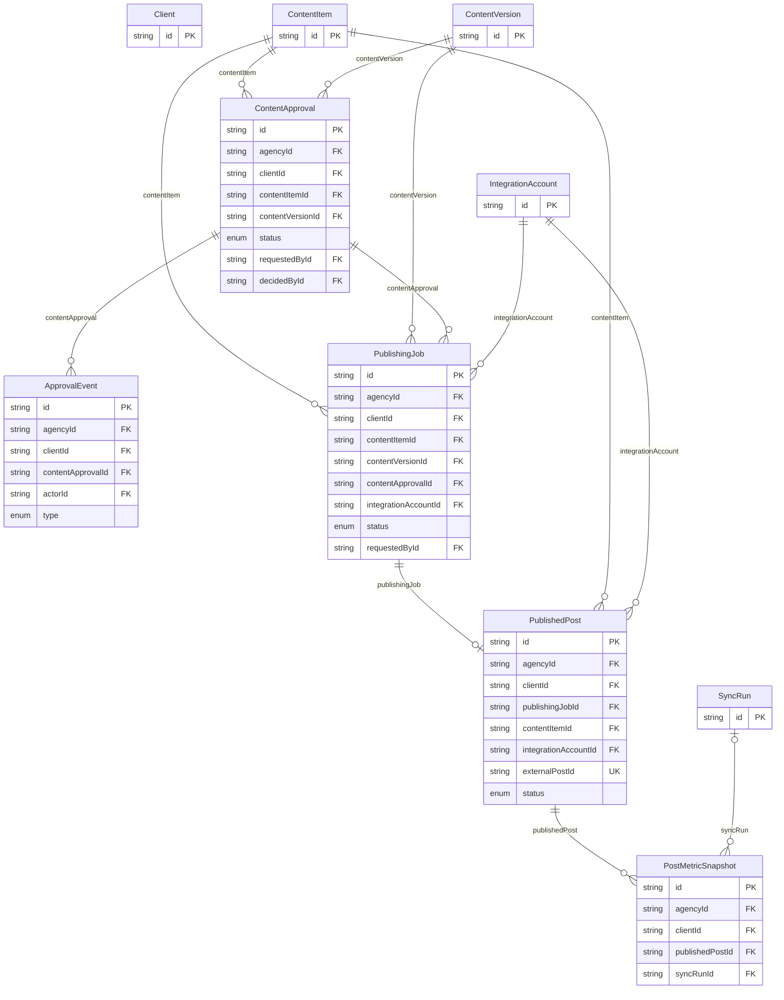

### Analytics

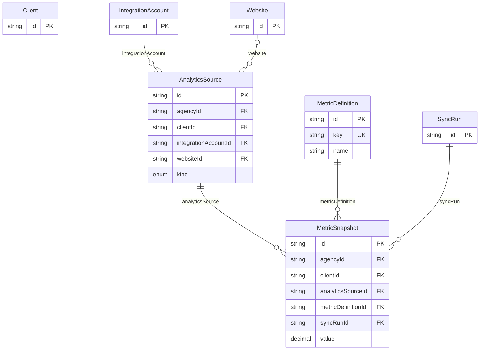

### Reporting

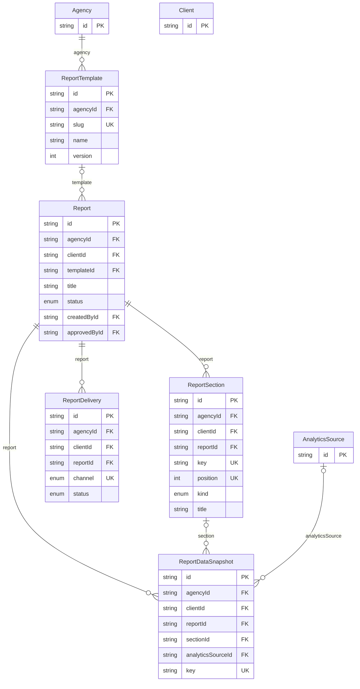

### Notifications, audit and worker jobs

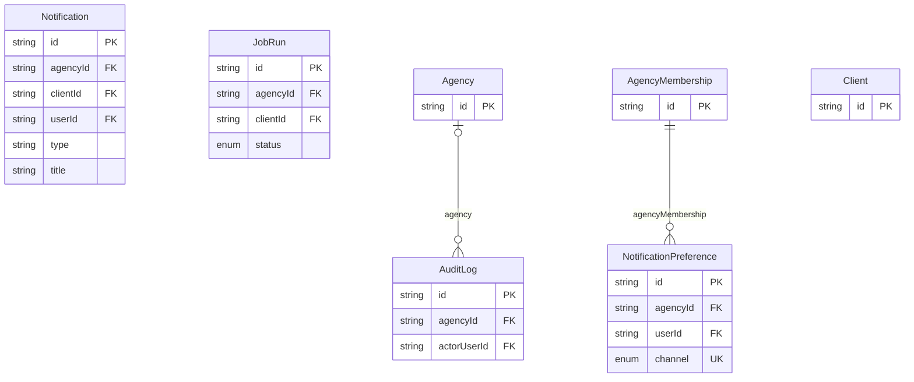

## Key relationships

| Parent | Child | Cardinality | Key | On delete | Notes |
| --- | --- | --- | --- | --- | --- |
| Agency | Client | 1 : n | `clients.agency_id` | Restrict | Archive agencies; unique `(agency_id, slug)` |
| Client | every client-owned table | 1 : n | `(client_id, agency_id)` | Cascade | Composite FK to `clients(id, agency_id)` |
| Agency | Role | 1 : n | `roles.agency_id` | Cascade | Unique `(agency_id, scope, key)`; `scope` = agency or client |
| Role ↔ Permission | RolePermission | n : m | `(role_id, permission_id)` | Cascade / Restrict | Roles are data; permission keys come from code (`rbac.ts`) |
| User ↔ Agency | AgencyMembership → AgencyMembershipRole ← Role | n : m : n | `(agency_id, user_id)`, `(role_id, agency_id)` | Cascade | A seat holds several roles, each must be this agency's (composite FK) and agency-scope (trigger) |
| User ↔ Client | ClientMembership → ClientMembershipRole ← Role | n : m : n | `(user_id, client_id)`, `(role_id, agency_id)` | Cascade | User must be an agency member (FK to agency membership); roles must be the same agency's |
| Agency / Client | Invitation → InvitationRole | 1 : n : n | `(client_id, agency_id)`, `(role_id, agency_id)` | Cascade | Unique `token_hash`; the Client role only on client-specific invitations (trigger) |
| Client | Project | 1 : n | `(client_id)` | Cascade | Unique `(client_id, slug)` |
| Project ↔ User | ProjectMembership | n : m | `(project_id, user_id)` | Cascade | User must be a member of the client |
| Project | SeoProject | 1 : 1 | `(project_id, client_id)` | Cascade | Also references the client's Website |
| SeoProject | Keyword / Competitor / SiteAudit / SeoIssue / BacklinkSnapshot | 1 : n | `(seo_project_id, client_id)` | Cascade | Keyword unique per `(project, term, country, locale, device)` |
| Keyword | KeywordRankSnapshot | 1 : n | `(keyword_id, client_id)` | Cascade | Append-only history |
| SeoIssue | SeoIssueHistory | 1 : n | `(seo_issue_id, client_id)` | Cascade | Issue identity is `(seo_project_id, fingerprint)` across audits; may link to a Task |
| Website | WebsitePage | 1 : n | `(website_id, client_id)` | Cascade | Unique `(website_id, url)` |
| Integration | IntegrationAccount | 1 : n | `integration_id` | Restrict | Unique `(client_id, integration_id, external_account_id)` |
| IntegrationAccount | AnalyticsSource | 1 : n | `(integration_account_id, client_id)` | Cascade | Unique `(integration_account_id, external_id)` |
| IntegrationAccount | SyncRun → SyncError | 1 : n : n | `(…, client_id)` | Cascade | Sync run optionally targets one AnalyticsSource |
| AnalyticsSource × MetricDefinition | MetricSnapshot | n : m (+ time) | `(analytics_source_id, client_id)`, `metric_definition_id`, `(sync_run_id, client_id)` | Cascade / Restrict | One row per sync run: history is never overwritten |
| Project / Task | Task | 1 : n, self | `(project_id, client_id)`, `(parent_task_id, client_id)` | Restrict | Assignee must have access to the client (trigger) |
| Task | TaskDependency (task ↔ task) | n : m | `(task_id, client_id)`, `(depends_on_task_id, client_id)` | Cascade | CHECK: not self; both tasks in the same client |
| Task | TaskComment / TaskAttachment / TaskEvent / TimeEntry | 1 : n | `(task_id, client_id)` | Cascade (Restrict for time) | Events are append-only |
| AutomationRule | AutomationRun → AutomationStepRun | 1 : n : n | `(rule_id, client_id)`, `(run_id, client_id)` | Cascade | Run records the rule `version` it executed; optional unique IdempotencyKey |
| ContentItem | ContentVersion | 1 : n | `(content_item_id, client_id)` | Cascade | Unique `(content_item_id, version_no)`, immutable; `content_items.current_version_id` points at one (trigger checks it is the item's own) |
| ContentVersion | ContentApproval | 1 : n | `(content_version_id, content_item_id, client_id)` | Restrict | Approval is for one specific version of one item |
| ContentApproval | ApprovalEvent | 1 : n | `(content_approval_id, client_id)` | Cascade | Append-only trail |
| ContentApproval → IntegrationAccount | PublishingJob | n : 1 : 1 | `(content_approval_id, content_version_id, client_id)`, `(integration_account_id, client_id)` | Restrict | Trigger: approval must be `approved` for that version; unique `(content_version_id, integration_account_id)` |
| PublishingJob | PublishedPost → PostMetricSnapshot | 1 : 1 : n | `(publishing_job_id, client_id)` | Restrict / Cascade | Unique `(integration_account_id, external_post_id)` |
| ReportTemplate (agency) | Report | 1 : n | `(template_id, agency_id)` | Restrict | Template must be the client's agency's |
| Report | ReportSection / ReportDataSnapshot / ReportDelivery | 1 : n | `(report_id, client_id)` | Cascade | Snapshot freezes the numbers; delivery unique `(report_id, channel, recipient)` |
| User ↔ Agency | NotificationPreference | n : m | `(agency_id, user_id)` | Cascade | Unique `(agency_id, user_id, event_type, channel)` |
| Agency / User | AuditLog | 1 : n | `agency_id`, `actor_user_id` | Restrict / SetNull | `client_id` is deliberately not an FK (see [deletion](#deletion-behaviour)) |

## Integrity beyond foreign keys

Prisma cannot express these, so they live as SQL at the end of `20261030100000_phase2_domain_model/migration.sql`.
`npm run test -w @automation/db` exercises every one against a real database (`src/schema-integrity.test.ts`).

| Rule | Mechanism |
| --- | --- |
| Stored credentials must be `v1.<keyId>.<iv>.<tag>.<data>` ciphertext (no plaintext tokens) | CHECK on `integration_accounts.encrypted_credentials` and `encrypted_webhook_secret` |
| A user referenced by a task assignee/reporter, time entry, task comment or content assignee has access to that client (platform admin, active client member, or agency staff with all-clients access) | Trigger `assert_user_has_client_access` |
| Agency seats hold only agency-scope roles (the external Client role is per client) | Trigger `assert_agency_role_scope` (plus composite FKs for same agency) |
| Invitations: lower-case email, hash-shaped token, expiry after creation; the Client role only on client invitations | CHECKs + trigger `assert_invitation_role` |
| Publishing needs an `approved` approval for exactly that version, checked on creation and again before the job can become `publishing`/`succeeded` | Trigger `assert_publish_approved` |
| `content_items.current_version_id` is a version of the same item | Trigger `assert_current_version_belongs` |
| `audit_log.client_id` exists and belongs to `audit_log.agency_id` (agency is filled in when omitted) | Trigger `assert_audit_client_in_agency` |
| History cannot be edited | Trigger `prevent_update` on rank, backlink, metric, post-metric and report-data snapshots, SEO issue history, task events, approval events, AI usage and content versions; `protect_audit_log` blocks update and delete on `audit_log` unless the transaction sets `app.allow_purge = 'on'` |
| Task cannot depend on or be the parent of itself; time entries end after they start and have a task or project; report period is ordered; sync runs finish after they start; ranking positions are ≥ 1; sizes, counts and token/cost values are ≥ 0; decided approvals have `decided_at`; client report interval > 0 | CHECK constraints |

Not enforced in the database (documented limits): assignment eligibility is checked when the row is written, so removing
someone from a client later does not unassign them (a membership-removal workflow must unassign them; not built yet); "one active brand guideline per
client" and cycle detection in task dependencies are application rules; a SEO issue's page is not forced to belong to the
SEO project's website.

## Duplicate prevention

| Record | Unique key |
| --- | --- |
| Provider catalogue | `integrations.key` |
| A client's account at a provider | `(client_id, integration_id, external_account_id)` |
| Analytics property | `(integration_account_id, external_id)` |
| Published post at a provider | `(integration_account_id, external_post_id)`; one job per `(content_version_id, integration_account_id)` |
| Inbound webhook | `(integration_id, external_event_id)` |
| Metric reading per sync run | `(sync_run_id, analytics_source_id, metric_definition_id, granularity, period_start, dimension_key)` |
| Keyword | `(seo_project_id, term, country, locale, device)`; rank reading per run `(sync_run_id, keyword_id, source, checked_on)` |
| SEO issue | `(seo_project_id, fingerprint)` |
| Report | `(client_id, template_id, period_start, period_end, revision)`; delivery `(report_id, channel, recipient)` |
| Idempotent requests | `(agency_id, scope, key)` |
| Per-client names | project slug, automation rule name, calendar name, website domain, page URL |

## Deletion behaviour

* **Archive, don't delete.** Agencies, clients, projects, rules, templates and content have `archived_at`/status; users have `deactivated_at`.
  `Agency -> Client` is `Restrict`, so an agency with clients cannot be deleted by accident.
* **Owned children cascade** from their parent (task → comments, events, attachments; keyword → rank snapshots; report → sections, snapshots, deliveries).
* **Independent aggregates restrict.** A project, content item, integration account, website, competitor or analytics source that other rows point to
  cannot be deleted; disconnecting an integration sets `status = disconnected`.
* **People** are `SET NULL` on history (assignee, author, actor, requester) so records survive a deleted user; time entries `Restrict`
  (billing); memberships and notifications cascade.
* **Hard-deleting a client** (`DELETE FROM clients`) is the explicit purge path: everything the client owns cascades away in one transaction.
  `audit_log` rows are intentionally *not* foreign-keyed to the client, so they survive; removing them as well (legal erasure) needs
  `SET LOCAL app.allow_purge = 'on'` in the same transaction. No application code does either today.

## History and append-only data

Never updated, always inserted: `keyword_rank_snapshots`, `backlink_snapshots`, `metric_snapshots`, `post_metric_snapshots`,
`report_data_snapshots`, `seo_issue_history`, `task_events`, `approval_events`, `ai_usage_records`, `content_versions`, `audit_log`.

* A re-sync inserts new rows under a new `sync_run`; "current" is the latest `captured_at` per (source, metric, period, dimensions).
  Provider revisions (e.g. Search Console finalising data) therefore leave a trail, and `is_final` marks provisional values.
* Reports store the numbers they used in `report_data_snapshots`, so a delivered report can be reproduced after later syncs.
* Regenerating a report creates `revision + 1`; earlier revisions stay.

## Secrets

* `integration_accounts.encrypted_credentials` / `encrypted_webhook_secret` hold only AES-256-GCM ciphertext produced by
  `@automation/integrations` (key from `ENCRYPTION_KEY`, key id embedded for rotation, ciphertext bound to `client:provider`
  context). A CHECK constraint rejects anything that is not in that format. Decrypt only in the worker or a server action.
* `users`/`accounts`: Better Auth stores a password **hash**; the OAuth token columns of `accounts` are unused (sign-in is email + password only).
* Other tables hold no secrets: `ai_jobs` stores prompts and outputs but never API keys; `webhook_events.signature_valid` records the
  result of verifying a signature but not the secret; file tables store storage keys, not public URLs.

## Data lifecycle

1. **Onboarding.** An agency is created and `syncRbac` provisions its roles and permissions. Staff get an `agency_membership`
   (optionally with all-clients access). A client is created under the agency (audit entry in the same transaction), then websites,
   projects (+ SeoProject), client memberships and a brand guideline.
2. **Connecting data sources.** OAuth/API credentials are encrypted into an `integration_account` (`active`). Pickable properties become
   `analytics_sources`. Expired or revoked credentials move the account to `needs_reauth`, never silently ignored.
3. **Scheduled sync.** The worker loops over active clients (`forEachActiveClient`), creates a `sync_run` per account/source
   (`queued → running → succeeded | partial | failed`), writes errors to `sync_errors`, then inserts `metric_snapshots`,
   `keyword_rank_snapshots`, `backlink_snapshots` and `post_metric_snapshots` tagged with the run. Inbound webhooks are stored in
   `webhook_events` (deduplicated, signature checked) and processed idempotently.
4. **SEO work.** Audits (`site_audits`) upsert `seo_issues` by fingerprint and append `seo_issue_history`; an issue can spawn a `task`.
   Tasks move through their statuses, each change appending a `task_event`; people log `time_entries`.
5. **Content.** A `content_item` gets immutable `content_versions` (human or AI via `ai_jobs` + `ai_usage_records`). A version is sent for
   approval (`content_approval` + `approval_events`). Only an `approved` approval allows a `publishing_job`
   (`queued → scheduled → publishing → succeeded | failed`), which creates one `published_post`; engagement is then tracked in `post_metric_snapshots`.
6. **Automation.** `automation_rules` (per-client data) fire `automation_runs` with step records; `idempotency_keys` make retries safe.
   Rules that publish or change a website always require approval.
7. **Reporting.** A `report` is built from an agency template: sections plus a frozen `report_data_snapshot`, optional approval,
   then `report_deliveries` (email/download) with delivery status.
8. **Notifications and audit.** Events create `notifications` honouring `notification_preferences`; every create/update/delete of client
   data writes `audit_log` in the same transaction.
9. **Retention and offboarding.** Pausing a client stops scheduled jobs; archiving makes it read-only and hides it from switchers.
   Suggested retention (not implemented in this phase): `sync_errors` and processed `webhook_events` payloads 90 days, expired
   `idempotency_keys` immediately, metric/rank/backlink history ≥ 25 months (partition `metric_snapshots` by `period_start` once it grows past
   ~100M rows), AI usage and audit log per the agency's contract. A purge follows [Deletion behaviour](#deletion-behaviour).

## Conventions and operations

* IDs are UUID v4 stored as `text` (Better Auth and the Phase 1 tables already use string ids; every key and foreign key is text, so there are no cast issues).
  Tables added in Phase 2 use `timestamptz(3)`; Phase 1 tables (`users`, `sessions`, `clients`, `websites`, `job_runs`, `audit_log.created_at`, …) remain
  `timestamp(3)` holding UTC. Enums are native PostgreSQL enums, JSON is `jsonb`, money is integer micro-units (`bigint`), ratios/positions are `numeric`.
* `clients` also carries `industry`, `goals`, `target_locations` and `account_owner_id` (a trigger checks the owner can work on the client); `projects` carries `goals` and `settings` (social requirements). See [client-project-management.md](client-project-management.md).
* `projects`, `tasks`, `keywords` and `content_items` carry `is_sample` (default false). The development seed sets it so the UI can label seed rows and never present them as live provider data (see [design-system.md](design-system.md)).
* Every client-owned table has an index starting with `client_id` (or a composite key that does) so tenant-filtered queries stay index-backed.
* Adding a client-owned table: add `agency_id` + `client_id`, the composite `client` relation, `@@unique([id, client_id])`, register it in
  `TENANT_MODELS` (`src/scope.ts`; a test fails if you forget), add cross-client tests, and use composite FKs for every reference to another client-owned table.
* Commands: `npm run db:migrate` (dev, creates a migration), `npm run db:deploy` (apply), `npm run db:seed` (idempotent; permissions, default roles, provider and
  metric catalogues, the default agency, SARJ Worldwide and, outside production, sample SEO/task/content rows).
  Checks: `npm run db:validate`, and `prisma migrate diff --from-config-datasource --to-schema prisma/schema --exit-code` to detect drift.
* Upgrading an existing Phase 1 database is data-preserving: the migration creates a "Default Agency", moves existing clients, websites, job runs and
  audit rows under it, converts memberships to `client_memberships` with matching roles, and refuses to run if the legacy `integration_connections` table has rows.
  Run `npm run db:seed` afterwards to attach role permissions.

## Provider integration additions (Phases 7–9)

All tenant-scoped (`agency_id` + `client_id`, composite foreign keys, registered in `TENANT_MODELS`). Details: [integrations-framework.md](integrations-framework.md), [integrations-gohighlevel.md](integrations-gohighlevel.md), [integrations-seranking.md](integrations-seranking.md).

* `sync_runs.summary` (JSONB): source (`live`/`mock`), unsupported features, per-resource counts. A partial unique index allows one queued/running run per integration account. `sync_errors` keep only short safe text.
* GoHighLevel: `crm_contacts`, `crm_pipelines`, `crm_opportunities`, `crm_conversations` (metadata only), `crm_automations` (campaign/workflow), `provider_social_accounts`, `provider_social_posts`, `provider_social_stats` (append-only). Unique on `(integration_account_id, external_id)`.
* Publishing: `publishing_jobs.target_account_ids`, `request_sent_at`, status `needs_review` (outcome unknown; never retried automatically). `publishing_jobs_sent_chk` stops a job that sent a request from returning to `queued`.
* SE Ranking: `provider_seo_projects` (discovered provider project, linked by a person to one `seo_projects` row and one search engine). Provider identity (`external_source`, `external_id`) on `keywords`, `site_audits`, `competitors`; `external_source` on `seo_issues`; `keywords.search_volume`; `competitors.provider_data`. Enum values `se_ranking` on `RankSource` and `BacklinkSource`.
